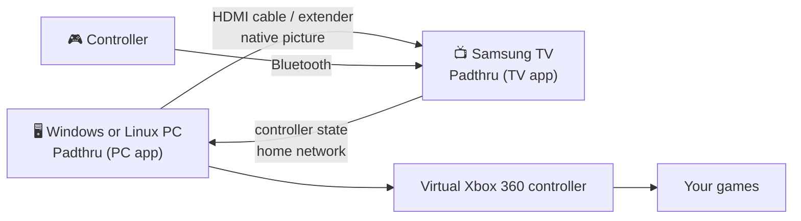

<p align="center">
  
</p>

<h1 align="center">Padthru</h1>

<p align="center">
  <b>Play PC games on your Samsung TV with the controller that's already paired to the TV.</b><br>
  Native HDMI picture. No USB extenders, no dongles taped to the wall, no streaming.
</p>

<p align="center">
  <a href="LICENSE"></a>
  
  
  <a href="https://github.com/labanmne/padthru/releases/latest"></a>
</p>

---

## The problem

Your gaming PC is in another room. You run its picture to the living-room TV over a long HDMI cable, a fiber HDMI cable or an HDMI-over-Ethernet extender, and the picture is perfect.

The controller is the problem. Bluetooth won't reach the PC through the walls, USB extender kits cost $200 or more, and streaming apps like Moonlight or Steam Link compress the picture you just went to the trouble of wiring.

## The idea

Your Samsung TV already talks to your controller. **Padthru** is a small TV app that shows the PC's HDMI input full screen and quietly forwards the controller to the PC over your home network. On the PC it appears as an ordinary Xbox controller.



The picture never leaves the cable. Only the controller travels over the network, and that's a few hundred bytes a second.

## Features

- **Native picture.** The HDMI input is shown as is: 4K, HDR and high refresh rates pass straight through, with the TV's Game Mode still active.
- **Zero setup on the network.** The TV app finds the PC by itself. You can also set the address by hand.
- **Works with any game.** Games see a standard Xbox 360 controller (XInput), so anything that supports an Xbox controller, including Steam Input, just works. Rumble is passed back to the TV where it supports it (experimental).
- **Up to four controllers** paired to the TV at once (tested with one so far).
- **Windows and Linux.** On Windows it's a tray app; on Linux (SteamOS, Bazzite, Ubuntu, Fedora, Arch and others) a background service. Both use next to no CPU.
- **Open source**, MIT licensed.

## Requirements

| | |
|---|---|
| **TV** | A Samsung smart TV running Tizen that allows Developer Mode. Tested on a 2021 Q70A (Tizen 6.0). |
| **Controller** | Any Bluetooth controller your TV accepts. Tested with a DualShock 4. |
| **PC** | Windows 10 or 11 (64-bit) with the free [ViGEmBus](https://github.com/nefarius/ViGEmBus/releases/latest) driver, **or** Linux with Python 3.8+ ([details](docs/linux.md)). |
| **Picture** | Your PC connected to the TV over HDMI, by any means: cable, fiber HDMI or an HDMI-over-Ethernet extender. |
| **Network** | TV and PC on the same home network. |

## Installation

### 1. On the PC

#### Windows

1. Install the **[ViGEmBus driver](https://github.com/nefarius/ViGEmBus/releases/latest)** (`ViGEmBus_*_x64_x86_arm64.exe`). Restart if it asks.
2. Download **`Padthru.exe`** from the [latest release](https://github.com/labanmne/padthru/releases/latest) and run it.
3. When Windows Firewall asks, **allow access on Private networks**. The TV needs to reach the PC.
4. Answer **Yes** to "Start with Windows" if you want it always ready.

Padthru now sits in the tray next to the clock. Its menu shows the PC's address and whether the TV is connected.

> Release files are built by [GitHub Actions](.github/workflows/release.yml) straight from the tagged source. Windows SmartScreen may still warn about a new, unsigned app: click **More info → Run anyway**, or build it yourself (see [Building from source](#building-from-source)).

#### Linux

```bash
curl -fsSLO https://github.com/labanmne/padthru/releases/latest/download/install-linux.sh
bash install-linux.sh
```

The installer runs as your normal user and asks for sudo only if it has to: to let you create virtual controllers (the same udev rule Steam uses; usually already there if Steam is installed) and to open port 47811 if a firewall is on. Padthru then runs as a background service that starts when you sign in. [docs/linux.md](docs/linux.md) explains every step, how to run it without the installer, and how to remove it.

### 2. On the TV

Samsung TVs install apps from outside the store through **Developer Mode**. You do this once.

1. **Turn on Developer Mode.** Open **Apps** on the TV and type **1 2 3 4 5** on the remote. Switch Developer Mode **On**, enter the IP address of the computer you'll install from (on Windows it's shown in the Padthru tray menu; on Linux the installer prints it) as **Host PC IP**, then restart the TV (hold the power button until it turns off and on).
2. **Install Padthru on the TV.** On that computer, download **`Padthru.wgt`** from the [latest release](https://github.com/labanmne/padthru/releases/latest) and install it with **[Apps2Samsung](https://github.com/Apps2Samsung/Apps2Samsung)** (Windows, macOS and Linux), a free installer that signs the app for your TV: select your TV, choose the custom `.wgt` option and pick `Padthru.wgt`. The first install may ask you to sign in with a Samsung account so it can create your developer certificate.
3. **Recommended picture settings** for the HDMI port your PC uses, under *Settings → General → External Device Manager*:
   - **Input Signal Plus: On.** Without it, the TV only accepts limited resolutions and no HDR on that port.
   - **Game Mode: On.** This gives the lowest input lag.

> Prefer the official tools? `Padthru.wgt` also installs with [Tizen Studio](https://developer.samsung.com/smarttv/develop/getting-started/setting-up-sdk/installing-tv-sdk.html) and your own Samsung certificate.

### 3. Pair the controller with the TV

If it isn't paired yet: on the TV, open *Settings → Connection → Bluetooth Device List*, put the controller in pairing mode (DualShock 4: hold **Share + PS** until the light flashes) and select it.

## Usage

1. Turn on the controller and open **Padthru** from the TV's apps.
2. Padthru finds your PC, shows its HDMI input and connects the controller. The info panel hides itself after a few seconds.
3. Play.

If the picture shows the wrong input, press **1–4** on the remote once; Padthru remembers it.

### Remote control

| Key | Action |
|---|---|
| **1 – 4** | Show HDMI input 1–4 |
| **Red** | Show or hide the info panel |
| **Green** | Settings: PC address and HDMI input |
| **Back** | Exit Padthru |

On remotes without number or color keys, press the **123** button to bring up the on-screen keypad.

### Controller notes

- **The PS / Home button belongs to the TV.** It opens the TV menu and can't be taken over by apps. For the Xbox Guide button (Steam overlay, Game Bar), press **Share + Options together**.
- Games see an **Xbox 360 controller**, so they show Xbox button prompts.
- The touchpad and motion sensors aren't forwarded.

## Performance

Measured on a Samsung Q70A (2021) with a DualShock 4:

| | Result |
|---|---|
| **Picture lag** | Within one frame of the TV's normal HDMI input in Game Mode, measured with photos of a millisecond timer on a mirrored laptop. It feels identical. |
| **Picture quality** | 3840×2160 at up to 120 Hz with HDR, confirmed inside the app. |
| **Controller** | The TV delivers about **42 updates a second** from the controller, which adds roughly **12 ms** on average compared with a controller plugged into the PC. That's the same input path Moonlight's TV app uses, without Moonlight's video delay on top. |
| **Network** | Under 1 ms on a wired home network; a few hundred bytes per second. |

It's great for single-player and casual multiplayer. Competitive players who want every millisecond should plug the controller into the PC.

You can repeat the picture test with [`tools/lagtest.html`](tools/lagtest.html); see [docs/latency.md](docs/latency.md).

## Limitations

- **Samsung Tizen TVs only.** Padthru relies on Samsung's TV Window API. LG webOS or Android TV would need their own app; contributions are welcome.
- **The app has to stay open.** Pressing Home or switching apps stops controller input until you return to Padthru.
- **Windows and Linux** on the PC side, no macOS (it has no supported way to create a virtual controller). On Windows it relies on ViGEmBus, which is no longer developed upstream but still installs and works on Windows 10 and 11. **Linux support is new in 0.2.0** and was tested with a simulated TV ([details](docs/linux.md)); reports from real setups are very welcome.
- **Same network.** Automatic discovery searches the TV's own subnet (e.g. `192.168.1.x`). If your PC is elsewhere, enter its address under **Green → Settings**.
- **Trusted networks only.** The PC app accepts controller input from your local network on TCP port **47811** without a password, so keep the firewall rule to *Private* networks.

## Troubleshooting

The short version is below. [docs/troubleshooting.md](docs/troubleshooting.md) has more, and Linux has its own section in [docs/linux.md](docs/linux.md#troubleshooting).

| Symptom | Fix |
|---|---|
| **"Looking for your PC…" forever** | Make sure Padthru is running in the PC's tray, then check that Windows Firewall allows **Padthru** on Private networks. Or press **Green** and type the PC's address from the tray menu. |
| **Black screen or "No HDMI input"** | Press **1–4** to pick the PC's HDMI input. Make sure the PC is on and outputting to the TV. |
| **No 4K / HDR** | Turn on **Input Signal Plus** for that HDMI port, and use a cable or extender rated for 4K60 (18 Gbps). |
| **Controller does nothing in games** | Check that the info panel (**Red**) shows your controller and *Connected*. Some games need the controller connected before they start. |
| **"Padthru needs the ViGEmBus driver"** | Install [ViGEmBus](https://github.com/nefarius/ViGEmBus/releases/latest) and start Padthru again. |
| **"Port 47811 is already in use"** | Padthru is already running; look for its tray icon. |

## Building from source

```powershell
git clone https://github.com/labanmne/padthru
cd padthru
powershell -ExecutionPolicy Bypass -File tools\build.ps1
```

This produces `Padthru.exe`, `Padthru.wgt`, `padthru-linux.pyz`, `install-linux.sh` and `SHA256SUMS.txt` in `dist\`. It needs Python 3.10+ on Windows; the script installs `websockets`, `pystray`, `Pillow` and `PyInstaller`. On Linux, `python3 tools/build_pyz.py` builds just the Linux app.

To run the PC app straight from source: `pip install -r pc\requirements.txt`, then `python pc\padthru.py --console --debug`.

No Samsung TV at hand? [`tools/fake_tv.py`](tools/fake_tv.py) acts like the TV app: it connects to Padthru, presses every button and moves the sticks.

How the pieces talk to each other is described in [docs/how-it-works.md](docs/how-it-works.md).

## FAQ

**Why not just use Moonlight or Steam Link?**
They're great, but they re-encode the picture as video. If you already have an HDMI connection, Padthru keeps that native picture and only sends the controller over the network.

**Why not a USB-over-Ethernet KVM extender?**
The ones that carry a game controller (USB 2.0) cost $250 or more. Cheaper ones only pass a keyboard and mouse.

**Does it work with Xbox or DualSense controllers?**
Anything the TV accepts as a gamepad should work. Only the DualShock 4 has been tested so far; please report your results.

**Will it work on my TV model?**
Probably, if it runs Tizen and has Developer Mode. Please open an issue with your model either way, so this list can grow.

## Credits

Padthru stands on the shoulders of:
- [ViGEmBus / ViGEmClient](https://github.com/nefarius/ViGEmBus) by Benjamin Höglinger-Stelzer, the virtual controller driver on Windows, and the Linux kernel's `uinput` on Linux.
- [vgamepad](https://github.com/yannbouteiller/vgamepad) by Yann Bouteiller, the Python bindings for ViGEm.
- [websockets](https://github.com/python-websockets/websockets), [pystray](https://github.com/moses-palmer/pystray) and [Pillow](https://python-pillow.org/).
- [Apps2Samsung](https://github.com/Apps2Samsung/Apps2Samsung), which makes sideloading painless.

See [THIRD_PARTY_NOTICES.md](THIRD_PARTY_NOTICES.md) for licenses.

## License

[MIT](LICENSE). Samsung and Tizen are trademarks of Samsung Electronics; this project is not affiliated with or endorsed by Samsung.
