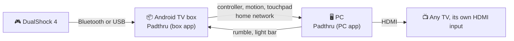

# Padthru on an Android TV box

Instead of the Samsung TV app, an **Android TV or Google TV box** (Android 12 or newer) can be the controller side of Padthru. Pair the controller to the box over Bluetooth or plug it into the box's USB port. The Padthru app on the box sends it to the PC, and the TV simply shows the PC's HDMI input like any other input.



Why you might prefer it:

- **Any TV.** Nothing has to run on the TV, so it doesn't have to be a Samsung.
- **The TV's own HDMI input**, in Game Mode, without the extra frame of the in-app picture.
- **More of the DualShock.** Android 12 gives apps the **gyro and accelerometer**, the **touchpad**, the **light bar** and the **battery level**, and Padthru passes them on to the virtual DualShock 4 on the PC (Windows). Games and Steam can use gyro aiming and the touchpad, and a game's light bar color shows on the controller.
- **USB at full speed.** A DualShock 4 on the box's USB port reaches the PC at its full 250 updates a second.

> **New and experimental.** Tested on one box (a Skyworth HY44G operator box, Android TV 12, and Android TV 14 after the operator updated it) with a DualShock 4. Background mode came back by itself after a reboot that installed that update. The motion, touchpad and light bar data needs Padthru 0.4 on a Windows PC; the Linux PC app takes the buttons and sticks for now.

## Measured (Skyworth HY44G, DualShock 4)

| Controller connected to the box by | Updates a second | Gyro, accelerometer, touchpad | Light bar, battery | Rumble |
|---|---|---|---|---|
| **USB cable** | **250** (every 4.0 ms); the PC sees about 320 new states a second including motion, median gap 2.9 ms | ✓ | ✗ (Android doesn't expose them over USB on this box) | ✓ |
| **Bluetooth** | about 44 (every 22.5 ms, Android's Bluetooth power-saving interval; apps can't change it) | ✓ | ✓ | ✓ |

For comparison, the same controller on a Samsung TV: about 42 a second over Bluetooth and 190 over USB, with no motion, touchpad or light bar.

A wireless controller that needs the speed can use a USB wireless adapter in the box. Sony's own DualShock 4 USB Wireless Adaptor shows up as a wired DualShock 4, so it should keep everything (not tested yet). Third-party adapters usually pretend to be Xbox controllers, so they keep the speed but lose the motion sensors and touchpad.

## Install

The app isn't in the Play Store, so you install it once from a computer with [adb](https://developer.android.com/tools/releases/platform-tools):

1. On the box: *Settings → Device Preferences → About*, select **Build** seven times until it says you're a developer. Then *Device Preferences → Developer options* → turn on **USB debugging** (on many boxes this also allows network debugging; turn on *Network debugging* or *Wireless debugging* too if you see them).
2. On the computer, with the box's IP address (*Settings → Network*):
   ```bash
   adb connect 192.168.1.215:5555
   adb install Padthru-android.apk
   ```
   The box asks once whether to allow debugging from this computer: tick *Always allow* and confirm (switch the TV to the box to see it).
3. Pair the controller with the box: *Settings → Remotes & Accessories → Add accessory*, then hold **Share + PS** on a DualShock 4 until its light flashes. Or plug it into the box's USB port.

`Padthru-android.apk` comes with each [release](https://github.com/labanmne/padthru/releases/latest), or build it yourself with `tools/build_android.sh` (see [Building](#building)).

## Use: background mode (recommended)

Open **Padthru** on the box once. It starts its **background helper**, and from then on there's nothing to do: just switch the TV's input.

- **TV on the PC's input** (or anything other than the box): the helper takes the controllers and sends them to the PC. The box ignores them meanwhile, so nothing happens to whatever the box is playing.
- **TV on the box:** the helper lets go, and the controllers work on the box as usual.

The box keeps playing its own app (live TV, for example) the whole time, and the helper starts again by itself after a reboot or an update of the app.

How: Android only gives controller input to the app on screen, but the box's debug connection (adb, which you turned on to install Padthru) may read controllers directly. The app starts the helper through the box's **own** debug connection, so no computer is involved after installing. The first time, the box asks whether to allow debugging from `padthru@box`: choose **Always allow**. The helper reads the controllers' Linux input devices (sticks, buttons, motion sensors and touchpad at the controller's own rate), plays rumble through the kernel (or through Android's controller vibration API where the box's security policy doesn't allow writing to input devices), sets the light bar through Android, and learns which input the TV shows from **HDMI-CEC** (the box must have *HDMI-CEC* on, which most do). It checks every 0.7 seconds. The app re-checks every 15 minutes that the helper is running.

Keep in mind:

- **USB debugging has to stay on.** A firmware update from your TV operator might turn it off; open Padthru afterwards and it tells you.
- **Don't let the box sleep** while you want to play (it has to be awake to read the controller). Many boxes stay on when the TV switches to another input; check *Settings → Device Preferences → Power* or similar.
- The helper's log is `/data/local/tmp/padthru/helper.log` on the box, and it also writes its main events to the PC's Padthru log.
- To start it from a computer instead: `adb shell "$(cat android/start-helper.sh)"`. To stop it: `adb shell pkill -f padthru.Helper`, or turn USB debugging off.

## Use: on screen (without background mode)

If the box's debug connection is off, the app forwards controllers itself while it's open:

1. Make sure Padthru is running on the PC.
2. Open **Padthru** on the box. It finds the PC by itself and shows the connected controllers, their update rate, and what the PC sees them as.
3. Leave it open and switch the TV to the PC's HDMI input.

Padthru then has to stay open on the box, which keeps the box awake. The box remote still works (Back closes Padthru), and the controller's buttons never act on the box while Padthru is open.

If a controller is connected both by cable and Bluetooth, Linux on the box uses the Bluetooth connection. To switch to USB, turn the controller off (hold PS for ten seconds), plug it in, and press PS.

## Building

```bash
ANDROID_HOME=~/Android/Sdk bash tools/build_android.sh
```

It needs a JDK (17 works) and the Android SDK with a platform, build-tools and the NDK, and uses only the SDK's own tools (`aapt2`, `javac`, `d8`, the NDK's `clang`, `zipalign`, `apksigner`), with no Gradle and no libraries. The first build creates a signing key in `~/.config/padthru/`. Keep it: Android only installs an update over an existing install if it's signed with the same key.

The app lives in `android/`: `MainActivity.java` (the screen, and on-screen forwarding through Android's input APIs), `Helper.java` (the background helper, started with `app_process`), `Evdev.java` with `jni/padthru_evdev.c` (reading, grabbing and rumbling Linux input devices, built for 32- and 64-bit ARM with the NDK), `LocalAdb.java` (a minimal adb client for the box's own debug connection), `Starter.java` (starts the helper after boot and updates, and checks it every 15 minutes) and `PcLink.java` (finding the PC and a small WebSocket client).

## Protocol additions

The box app speaks the TV app's protocol (see [how-it-works.md](how-it-works.md)), says hello as `padthru-android`, and adds to each controller message:

| Field | Meaning |
|---|---|
| `g` | gyroscope, degrees per second `[x, y, z]` (the DualShock's pitch, yaw, roll axes) |
| `ac` | accelerometer, in g `[x, y, z]` |
| `t` | up to two touchpad fingers, each `[x, y]` from 0 to 1 or `null` |
| `bat` | battery percent |
| `usb` | whether the controller is on a cable |

The PC sends `{"l": [index, red, green, blue]}` when a game sets the DualShock 4 light bar, next to the rumble message `{"r": [...]}`.
